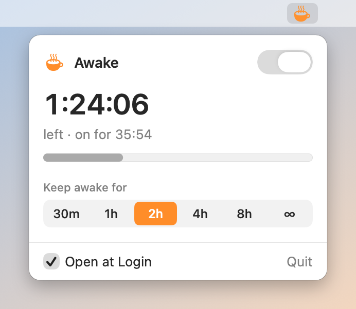
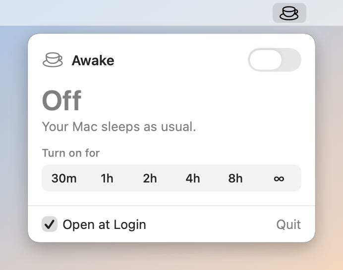

# Awake

A tiny macOS menu bar app that keeps your Mac and its display awake.

Click the cup in the menu bar to turn Awake on, either until you turn it
off or for a set time (30 min, 1 h, 2 h, 4 h, 8 h). While it is on, the
panel shows how much time is left with a progress bar, or how long it has
been running when it is on until turned off. The cup turns orange and
steams while Awake is on.

<p align="center">
  <picture>
    <source media="(prefers-color-scheme: dark)" srcset="docs/screenshots/panel-on-dark.png">
    
  </picture>
  <picture>
    <source media="(prefers-color-scheme: dark)" srcset="docs/screenshots/panel-off-dark.png">
    
  </picture>
</p>

Awake adds itself to your login items the first time you open it from
the Applications folder, so it is in the menu bar after every restart.
Untick **Open at Login** in the panel to stop that.

## Install

Download `Awake-<version>.zip` from the
[latest release](https://github.com/whoyoux/awake/releases/latest), unzip
it and move `Awake.app` to your Applications folder. Releases are signed
with a Developer ID and notarized by Apple.

## How it works

Awake holds an IOKit power assertion of type
`PreventUserIdleDisplaySleep`, the same one `caffeinate -d` creates. It
stops the display from idle sleeping, which also keeps the system awake.
It does not spawn `caffeinate`; when you turn Awake off or quit it, the
assertion is gone, and the kernel releases it automatically if the app
exits for any reason.

You can see it while Awake is on:

```sh
pmset -g assertions | grep Awake
```

Awake does not stop sleep when you close the lid of a laptop (the same as
`caffeinate -d`).

## Requirements

- macOS 14 Sonoma or later.

## Building

Open `Awake.xcodeproj` in Xcode and run the **Awake** scheme, or from the
command line:

```sh
xcodebuild -project Awake.xcodeproj -scheme Awake -configuration Debug -derivedDataPath build/DerivedData build
```

The app has no third-party dependencies.

Release builds are made with `scripts/release.sh` (see the comment at its
top for the one-time signing and notarization setup).

## Privacy

Awake collects no data and makes no network connections.

## Licence

MIT. See [LICENSE](LICENSE).
